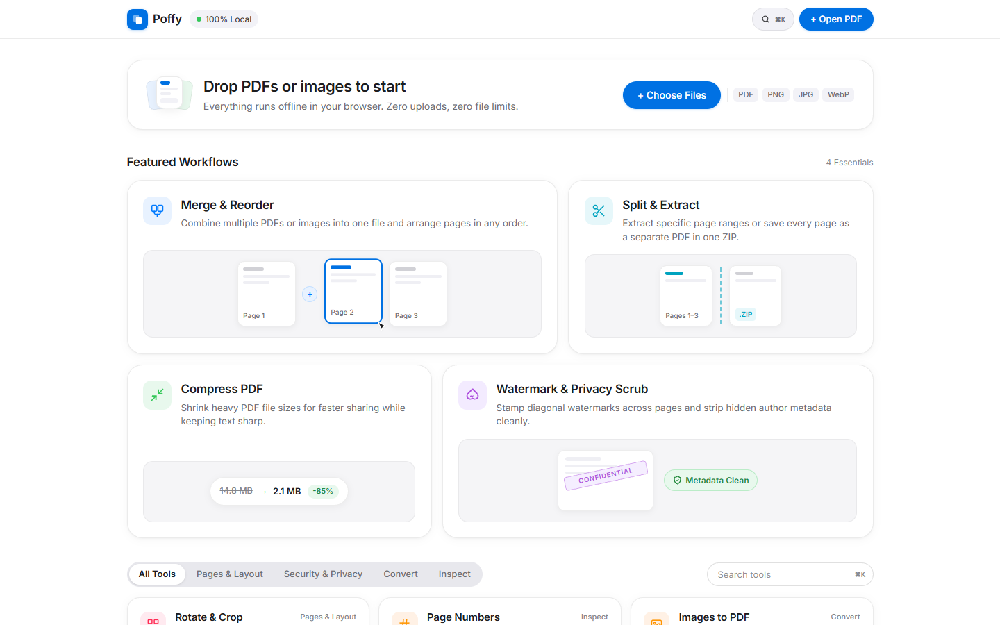
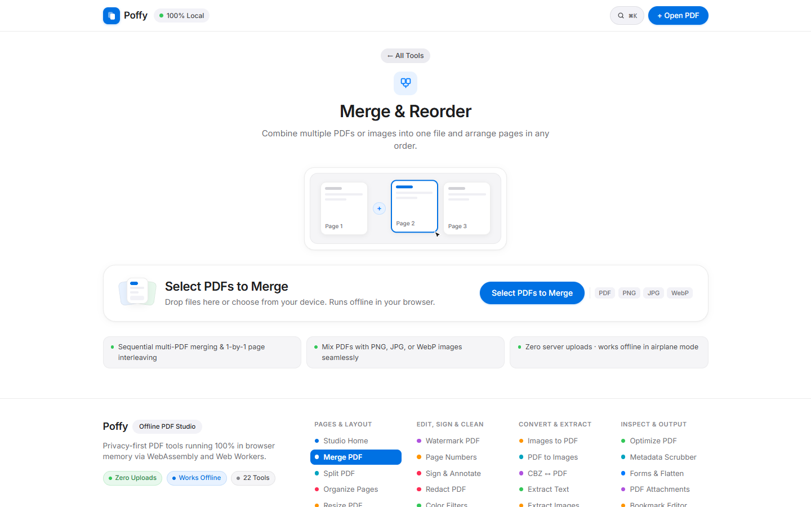
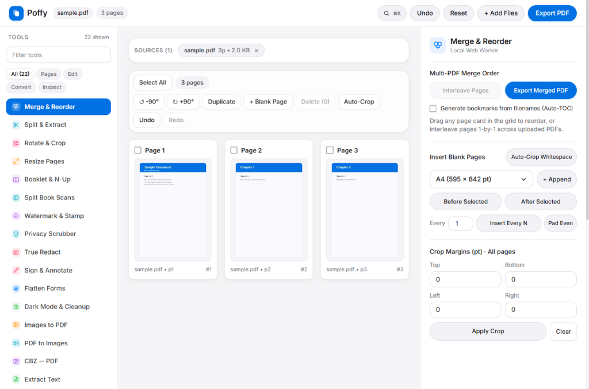

# Poffy — Offline PDF Studio

**Poffy** is a 100% client-side, privacy-first, offline-capable PDF studio built with modern JavaScript, WebAssembly, and Web Workers. Every document stays strictly inside your browser's memory — zero files, filenames, or telemetry are ever uploaded to an external server.

---

## Screenshots

### Home
<kbd>
  
</kbd>

### Merge PDF
<kbd>
  
</kbd>

### Workspace
<kbd>
  
</kbd>

---

## Core Capabilities (29 Offline Tools)

Poffy provides a unified workspace alongside dedicated, SEO-ready pages for each tool (plus `/about/`, `/disclaimer/`, and `/privacy-policy/`):

### Pages, Geometry & Layout
| Tool | Route | Capabilities |
|---|---|---|
| **Merge PDF** | `/merge-pdf/` | Combine multiple PDFs sequentially or interleave pages 1-by-1, mix PDFs with images, and optionally auto-generate filename bookmarks (`Auto-TOC`). |
| **Split PDF** | `/split-pdf/` | Split by custom ranges (`1-3, 5, 8-end`), extract selected pages, split every *N* pages, or burst into a `.zip`. |
| **Organize Pages** | `/organize-pdf/` | Drag-and-drop reordering, instant rotation (`90°`/`180°`/`270°`), duplicate/delete, blank page insertion (fixed sizes, match-neighbor, every *N* pages, even-page pad), `MediaBox`/`CropBox` margin cropping, and offscreen Auto-Crop Whitespace detection. |
| **Resize PDF** | `/resize-pdf/` | Standardize mixed-size pages onto uniform presets (`A3`, `A4`, `A5`, `Letter`, `Legal`, `F4/Folio`) or custom dimensions (`pt`/`mm`/`cm`/`in`) with `Fit`, `Fill`, or `Original Center` scaling and orientation control. |
| **N-Up & Booklet** | `/nup-booklet/` | Multi-up sheet imposition (`2-up`, `4-up`, `6-up`, `9-up`) with configurable reading order, gutters, and cell borders, plus saddle-stitch duplex Booklet imposition (`[N, 1]`, `[2, N-1]`) with automatic multiple-of-4 padding and diagram preview. |
| **Split Spreads** | `/split-spreads/` | Cut 2-page book or manga spreads along an interactive draggable vertical/horizontal split divider by slicing `CropBox` and `MediaBox` cleanly, with cover-skip and LTR/RTL order options. |

### Edit, Sign & Privacy
| Tool | Route | Capabilities |
|---|---|---|
| **Watermark PDF** | `/watermark-pdf/` | Customizable text watermarks (center, corners, or diagonal tiled grid with automatic `@pdf-lib/fontkit` Unicode TTF fallback) and aspect-locked `PNG`/`JPG` image stamps. |
| **Page Numbers** | `/page-numbers/` | Dynamic `{n}`/`{total}` page numbering and legal **Bates Numbering** (`{bates:PREFIX:6}`) across single PDFs or multi-file batch `.zip` export with CSV manifest. |
| **Sign & Annotate** | `/sign-annotate/` | Vector e-Signatures (smooth quadratic Bezier draw pad, local typed cursive fonts, trimmed `PNG`/`JPG`/`WebP` signature stamps with local `localStorage` reuse) plus shapes, highlights, and free text flattened via shared rotation/CropBox-aware coordinates. |
| **Redact PDF** | `/redact-pdf/` | True permanent raster-burn redaction with interactive draw boxes and keyword/regex/PII (`Email`, `Phone`, `SSN/ID`) text matching; selective raster-burn (`200`–`300` DPI) or Paranoid Mode (all-page burn + `deepScrubPdf()`). |
| **Color Filters** | `/color-filters/` | Ink-Saver Grayscale, Dark Slate/Pure Invert reading modes, and Scan Cleanup (white-point lift, contrast boost, and Otsu auto-binarization) with live side-by-side preview. |
| **Compare PDF** | `/compare-pdf/` | Side-by-side visual page pixel diff (green/red change overlays and changed-pixel percentage badges) plus Myers word-level text diff with printable/exportable PDF diff summary reports. |

### Convert & Extract
| Tool | Route | Capabilities |
|---|---|---|
| **Images to PDF** | `/images-to-pdf/` | Batch convert `JPG`, `PNG`, and `WebP` (decoded via `OffscreenCanvas`) into `A4`, `Letter`, or original-size PDF pages. |
| **PDF to Images** | `/pdf-to-images/` | Rasterize PDF pages to `PNG`, `JPEG`, or `WebP` (`1×`–`3×` scale) off the main thread; exports single image or `.zip`. |
| **CBZ ↔ PDF** | `/cbz-pdf/` | Bidirectional offline comic archive converter: unpack `.cbz` archives with natural numeric sorting and `__MACOSX`/dotfile filtering into PDFs, or render PDFs into zero-compression store-mode `.cbz` archives. |
| **Word → PDF** | `/docx-to-pdf/` | Convert `.docx` documents directly to paginated vector PDFs (`A4`/`Letter`, `Normal`/`Compact` margins) preserving headings, inline bold/italic/underline/color runs, lists, tables, and embedded PNG/JPEG images; auto-converts dropped `.docx` files with immediate **Download PDF** or **Open in Poffy Studio**. |
| **Excel → PDF** | `/xlsx-to-pdf/` | Render `.xlsx`, `.xls`, and `.csv` spreadsheets into crisp vector PDF tables (`Landscape`/`Portrait`, `All Sheets`/`First Sheet Only`) with proportional auto-fitted columns, wrapped cells, `#f5f5f7` header shading, and repeated headers across page breaks. |
| **PowerPoint → PDF** | `/pptx-to-pdf/` | Convert `.pptx` presentations into slide-matched vector PDFs (`16:9`/`4:3` EMU dimensions) preserving backgrounds, positioned text frames, bullets, native tables, and embedded pictures. |
| **PDF → Markdown** | `/pdf-to-markdown/` | Reconstruct headings (`#`–`###`), bold/italic runs, bullet/ordered lists, and GFM pipe tables into UTF-8 `.md` with configurable page separators (`---`, HTML comments, or continuous flow) and scanned-PDF detection. |
| **PDF → Word** | `/pdf-to-docx/` | Export PDF headings, styled `TextRun` paragraphs, lists, and multi-column tables into editable Microsoft Word (`.docx`) files via lazy Web Worker `docx` chunk with `Flowing Document` or `Preserve Line Breaks` layout modes. |
| **PDF → Excel** | `/pdf-to-xlsx/` | Cluster aligned column regions and text rows into structured `.xlsx` workbooks (`One Sheet per Page` or `Combine All Pages`, `All Text Rows` or `Detected Tables Only`) via lazy SheetJS worker chunk. |
| **PDF → PowerPoint** | `/pdf-to-pptx/` | Export PDFs as aspect-ratio-matched `.pptx` decks in **High-Fidelity Visual Slides** (`OffscreenCanvas` JPEG/PNG) or **Editable Text Slides** (headings, bullets, and tables) via lazy `pptxgenjs` worker chunk. |
| **Extract Text** | `/extract-text/` | Reading-order text reconstruction (`Y`-bucketed + `X`-sorted) exporting `.txt` (optional page markers), inferred-heading Markdown (`.md`), or structured coordinate `.json`, with single download, clipboard copy, batch `.zip`, and scanned-PDF detection. |
| **Extract Images** | `/extract-images/` | Enumerate raw `/Subtype /Image` streams locally, extract `/DCTDecode` JPEGs and `/JPXDecode` JP2s losslessly without re-encoding, reconstruct `/FlateDecode` RGB/CMYK/`/SMask` PNGs, deduplicate assets, filter spacers, and export `.zip`. |

### Inspect, Metadata & Output
| Tool | Route | Capabilities |
|---|---|---|
| **Optimize PDF** | `/optimize-pdf/` | Three compression tiers (`Lossless Object Streams & Orphan Pruning`, `Balanced Smart XObject Image Recompression`, and `Maximum DPI Raster Optimization`) with before/after size diff badges. |
| **Metadata Scrubber** | `/metadata-scrubber/` | Pre-scrub Privacy Audit inspecting Info dictionary fields, XMP `/Metadata` stream size, page `/Thumb` previews, `/OpenAction`, `/AA`, and `/Names -> /JavaScript`, with selective toggles and reusable `deepScrubPdf()`. |
| **Forms & Flatten** | `/flatten-pdf/` | Inspect AcroForm fields (`PDFTextField`, `PDFCheckBox`, `PDFDropdown`, `PDFRadioGroup`), edit values, and flatten forms into static page graphics. |
| **PDF Attachments** | `/pdf-attachments/` | Walk `/EmbeddedFiles` name trees, inspect and extract attachments (single or `.zip`), embed new files via `pdfDoc.attach()` preserving MIME types and UTF-8 filenames, and prune removed streams cleanly. |
| **Bookmark Editor** | `/bookmark-editor/` | Interactive nested PDF `/Outlines` tree editor (`readOutlinesFromPdf` + Unicode `PDFHexString` serializer) with add sibling/child, indent/outdent, reorder, and live side-by-side page jump preview. |

---

## Architecture & Performance

- **Virtual Page Graph:** Reordering, rotating, selecting, duplicating, and cropping mutate lightweight in-memory page descriptors and CSS transforms at 60fps. `pdf-lib` serialization runs only when exporting or splitting.
- **Coordinate & Overlay Precision:** Shared `overlay-coords.js` and `geometry.js` helpers handle `CropBox` offsets, page scaling, and `0°`/`90°`/`180°`/`270°` `/Rotate` transforms uniformly across redaction, signatures, annotations, cropping, and imposition.
- **Dedicated Web Workers & Lazy Bundles:**
  - `src/workers/pdf-ops.worker.js` executes `pdf-lib` compilation, imposition, redaction, extraction, `fflate` ZIP packaging, and local PDF ↔ Office conversions (`docx`, `xlsx`, `pptxgenjs`, `fast-xml-parser`) off the main thread using lazy dynamic `import()` chunks and zero-copy `ArrayBuffer` transfers.
  - `src/workers/render.worker.js` executes `pdfjs-dist` (`OffscreenCanvas`) thumbnail rendering, high-resolution previews, and image rasterization.
- **Lazy Thumbnail Grid:** Uses `IntersectionObserver` (`rootMargin: '300px'`) with a bounded LRU cache keyed by `${sourceFileId}:${sourcePageIndex}` and aggressive `URL.revokeObjectURL()`/`bitmap.close()`/`page.cleanup()` teardown.
- **Full Offline Support:** `vite-plugin-pwa` generates a Workbox service worker precaching all 29 feature HTML pages, 3 info pages (`/about/`, `/disclaimer/`, `/privacy-policy/`), JS/worker/lazy converter chunks, CSS, WebAssembly binaries, CMaps, and bundled fonts (`Inter-Regular.ttf`, `@fontsource/inter`).

---

## Security & Privacy Hardening

- **Zero External Runtime Calls:** No CDNs, external font hosts, or analytics. Passes strict `connect-src 'self'` CSP.
- **Strict CSP & HTTP Headers (`public/_headers` & `index.html`):** Enforces `script-src 'self' 'wasm-unsafe-eval'` (no `'unsafe-eval'`), `object-src 'none'`, `base-uri 'self'`, `frame-ancestors 'none'`, `X-Frame-Options: DENY`, and `Referrer-Policy: no-referrer`.
- **Safe DOM, OOXML & PDF Sandboxing:** UI components build DOM nodes via `createElement` and `textContent` (zero `innerHTML` sinks). `pdfjs-dist` runs with `isEvalSupported: false`, bounded `OffscreenCanvas` dimensions, and bounded page-range/ZIP limits. OOXML `.docx`/`.pptx` unpacking (`src/core/convert/ooxml-reader.js`) enforces anti-ZIP-bomb caps (`150 MB` uncompressed, `<= 1,500` entries) and disables XML entity expansion (`processEntities: false` in `fast-xml-parser`, no `DOMParser`).
- **Responsive Cancellation:** Cooperative `ABORT_JOB` signaling backed by hard `worker.terminate()` fallback and clean worker respawn.
- **Zero Persistent Document Storage:** Uploaded files and metadata never touch `localStorage`, `sessionStorage`, `IndexedDB`, or cookies (the Sign/Annotate studio optionally stores only user-drawn reusable signatures inside browser `localStorage` under `poffy_saved_signatures` with one-click clear).

---

## Technology Stack

- **Language:** ES2022+ JavaScript with JSDoc type annotations
- **Build & Styling:** Vite `6.x`, Tailwind CSS `4.x`, `vite-plugin-pwa` (Workbox)
- **PDF, Office & Archive Engines:** `pdf-lib`, `@pdf-lib/fontkit`, `pdfjs-dist`, `fflate`, `docx`, `xlsx` (SheetJS), `pptxgenjs`, `fast-xml-parser`

---

## Getting Started

### Prerequisites
- Node.js `>= 20` and npm `>= 10`

### Installation & Local Development
```bash
npm install
npm run dev
```
*(Note: `npm install` automatically runs `postinstall` (`node scripts/sync-static-assets.mjs`) to sync `Inter-Regular.ttf` and `pdfjs-dist` WASM/CMap/standard-font assets into `public/`.)*

### Production Build & Preview
```bash
npm run build
npm run preview
```
The compiled static site is emitted to `dist/` and is ready to deploy with zero server-side runtime on **Cloudflare Pages** or **Vercel**.

### Regenerating Feature Landing Pages & Sitemap
If you update `src/core/seo/features.js` or `src/core/seo/info-pages.js`, regenerate all 29 static feature HTML entry points, 3 info pages, and `public/sitemap.xml`:
```bash
npm run generate:pages
```

---

## Project Structure

```text
poffy/
├── index.html                    # Main studio shell & SEO metadata
├── vite.config.js                # Vite MPA, Worker & Workbox PWA config
├── package.json
├── public/
│   ├── _headers                  # Security, CSP & static cache headers
│   ├── robots.txt                # Crawler directives
│   ├── sitemap.xml               # Static sitemap for studio, 29 tools & info routes
│   ├── fonts/                    # Local Inter-Regular.ttf fallback font
│   └── icons/                    # PWA SVG/PNG icons & Open Graph card
├── scripts/
│   ├── sync-static-assets.mjs    # Copies local TTF & pdfjs-dist assets on install
│   ├── generate-icons.mjs        # Generates local PNG icons & OG card
│   └── generate-feature-pages.mjs# Generates 29 feature + 3 info HTML routes & sitemap
├── <feature-slug>/index.html     # Dedicated static entry pages per PDF feature
├── about|disclaimer|privacy-policy/index.html
└── src/
    ├── main.js                   # App bootstrap, feature/info routing & footer
    ├── styles/main.css           # Tailwind CSS, design tokens & custom controls
    ├── state/workspace.js        # Virtual Page Graph & memory monitor
    ├── core/
    │   ├── convert/              # Layout extractor, OOXML guard, PDF ↔ Office/Markdown converters
    │   ├── pdf/                  # Pure DOM-free pdf-lib/canvas PDF operations
    │   ├── render/               # pdfjs-dist worker runtime, client & LRU cache
    │   ├── seo/                  # Feature catalog (29 tools) & info page SEO metadata
    │   └── utils/                # Error types, range/Bates parsers, file I/O, ZIP
    ├── workers/
    │   ├── pdf-ops.worker.js     # Background pdf-lib, fflate & Office converter worker
    │   └── render.worker.js      # Background pdfjs-dist OffscreenCanvas worker
    └── ui/
        ├── actions/              # Worker job runners & progress handlers
        ├── components/           # TopNav, HeroDropzone, InfoPage, PageGrid, ToolInspector, ClaySelect, Modals
        ├── interactions/         # Drag-and-drop ingestion (PDF/Office/Image) & sortable grid
        └── utils/                # Safe DOM helpers, tool copy/icons/snippets & signature pad utilities
```
